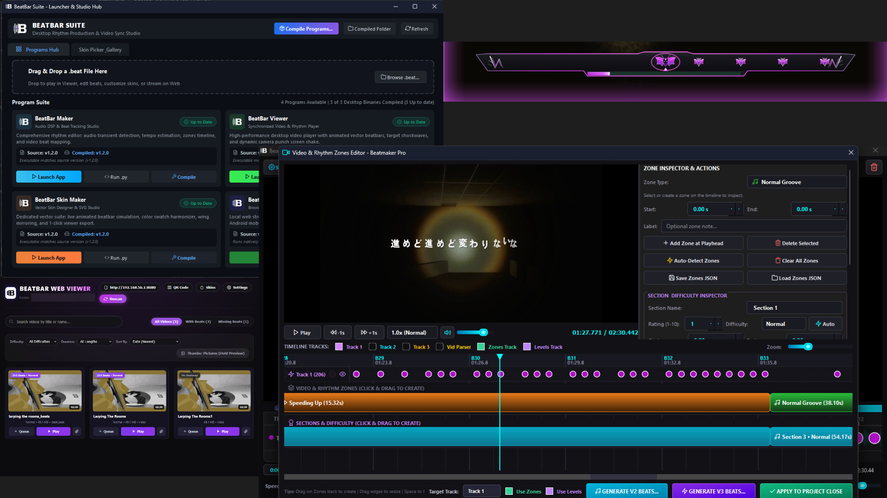

# Beatbar Suite

[](https://www.python.org/)
[](https://riverbankcomputing.com/software/pyqt/)
[](LICENSE)
[]()
[]()

A modular desktop and local network streaming platform for rhythm beatbar production, audio digital signal processing (DSP), vector skin design, synchronized video playback, and mobile client streaming.

---

<!-- Application Screenshot Preview -->
<p align="center">
  
</p>

---

## Table of Contents

- [Overview](#overview)
- [Installation Guide](#installation-guide)
  - [Prerequisites](#prerequisites)
  - [Automated Installation (Windows)](#automated-installation-windows)
  - [Manual Installation](#manual-installation)
  - [FFmpeg Setup](#ffmpeg-setup)
- [Quick Start](#quick-start)
  - [Running via Launcher Hub](#1-running-via-launcher-hub)
  - [Running via Standalone Batch Scripts](#2-running-via-standalone-batch-scripts)
  - [Running via Command Line](#3-running-via-command-line)
- [Suite Applications](#suite-applications)
  - [Beatbar Maker](#1-beatbar-maker-main)
  - [Beatbar Viewer](#2-beatbar-viewer-viewer)
  - [Beatbar Skins Maker](#3-beatbar-skins-maker-beatpanel)
  - [Web Beatbar Viewer](#4-web-beatbar-viewer-web)
  - [Suite Launcher](#5-suite-launcher-launcher)
- [Repository File Tree](#repository-file-tree)
- [Controls and Shortcuts](#controls-and-shortcuts)
- [File Formats and Technical Specifications](#file-formats-and-technical-specifications)
- [Credits and Third-Party Licenses](#credits-and-third-party-licenses)
- [License](#license)

---

## Overview

The Beatbar Suite connects audio analysis, vector rendering, video playback, and mobile streaming into a unified environment. The suite allows users to import media, automatically detect percussive transients across multiple frequency bands, sequence rhythm zones, compile assets into portable `.beat` archives, and play back media with synchronized HUD overlays and dynamic screen effects.

```
       [ Audio / Video Source ]
                  |
                  v
         [ Beatbar Maker ] ------ (Audio DSP / Transient Detection / Zones)
                  |
        +---------+---------+
        |                   |
        v                   v
  [.json Beatmap]     [.beat Archive]
        |                   |
        +-------------------+-------------------+
        |                   |                   |
        v                   v                   v
 [ Beatbar Viewer ]  [ Web Streamer ]    [ Skin Studio ]
 (Desktop Video)     (Android / Browser) (SVG Preview)
```

---

## Installation Guide

### Prerequisites

- **Operating System**: Windows 10/11 (fully supported), Linux, or macOS.
- **Python**: Version 3.10 or newer (tested with Python 3.13).
- **FFmpeg**: Required for audio extraction from video files and video thumbnail generation.

---

### Automated Installation (Windows)

The repository provides an automated installation script in the `Guide` folder:

```bat
Guide\install_dependencies.bat
```

This script:
1. Detects the active Python interpreter.
2. Updates `pip` to the latest release.
3. Installs all required dependencies from `requirements.txt`.
4. Runs verification imports across all packages.
5. Checks if `ffmpeg.exe` is present in system `PATH`.

---

### Manual Installation

To install dependencies manually using a terminal or command prompt:

```bash
# 1. Update pip
python -m pip install --upgrade pip

# 2. Install required packages
pip install -r requirements.txt
```

#### Package Specification

| Package | Minimum Version | Component | Purpose |
|---|---|---|---|
| `PyQt6` | `>=6.5.0` | Maker, Viewer, Skins, Launcher | Desktop GUI framework and vector rendering engine |
| `opencv-python` | `>=4.8.0` | Maker, Viewer | Video frame extraction and decoding |
| `numpy` | `>=1.24.0` | Maker, Viewer | High-performance array mathematics and signal vectors |
| `scipy` | `>=1.10.0` | Maker | Audio digital signal filtering and peak detection |
| `librosa` | `>=0.10.0` | Maker | Audio feature analysis, tempo estimation, and transient tracking |
| `Pillow` | `>=9.5.0` | Maker, Web | Image processing and QR code rendering |
| `Flask` | `>=2.3.0` | Web | HTTP streaming server and REST backend |
| `qrcode[pil]` | `>=7.4.0` | Web | LAN pairing QR code generation for mobile clients |
| `pyinstaller` | `>=6.0.0` | Launcher *(Optional)* | Standalone Windows executable compilation engine |

---

### FFmpeg Setup

FFmpeg is required by the Maker to extract audio from video containers and by the Web Viewer to generate video thumbnails.

- **Windows via Winget**:
  ```powershell
  winget install Gyan.FFmpeg
  ```
- **Windows via Scoop**:
  ```powershell
  scoop install ffmpeg
  ```
- **Manual Installation**:
  Download a release build from [ffmpeg.org](https://ffmpeg.org/download.html), extract the archive, and add the `bin` folder to your system `PATH`.

---

## Quick Start

### 1. Running via Launcher Hub

Run the centralized desktop hub:

```bash
# Using batch file
run_launcher.bat

# Or via Python
python launcher/launcher.py
```

---

### 2. Running via Standalone Batch Scripts

Each application can be launched independently using the batch files located in the `Guide` directory:

| Application | Script Path | Description |
|---|---|---|
| **Beatbar Maker** | `Guide\run_beatbar_maker.bat` | Audio DSP editor and beat timeline studio |
| **Beatbar Viewer** | `Guide\run_beatbar_viewer.bat` | Desktop HUD player with synchronized beatbar |
| **Beatbar Skins Maker** | `Guide\run_skin_maker.bat` | Vector skin designer and live hit simulator |
| **Web Beatbar Viewer** | `Guide\run_web_viewer.bat` | Starts local web server and opens browser |
| **Suite Launcher** | `Guide\run_launcher.bat` | Central dashboard and compiler tool |
| **Dependency Installer** | `Guide\install_dependencies.bat` | Automated setup script |

> [!NOTE]
> All batch scripts in `Guide` automatically detect the project root and can be executed either directly inside `Guide\` or copied to the project root.

---

### 3. Running via Command Line

Applications can also be run directly as Python modules:

```bash
# Beatbar Maker
python -m main

# Beatbar Viewer (optionally pass a video path)
python -m viewer
python viewer/main.py "videos/track.mp4"

# Beatbar Skins Maker
python -m beatpanel

# Web Beatbar Viewer (with automatic browser launch)
python -m web
python web/run_web.py --open --port 8080
```

---

## Suite Applications

### 1. Beatbar Maker (`main/`)

The core authoring studio for analyzing media, generating beat maps, and configuring rhythm parameters.

- **Multi-Band DSP Engine (`v2` and `v3`)**:
  - Low-frequency transient extraction (bass and kick drums).
  - Mid-range energy envelope tracking (snares and rhythmic synth chords).
  - High-frequency percussive detection (hi-hats and clicks).
- **Tempo Tracking and Snap Grid**:
  - Automatic BPM estimation with confidence metric.
  - Snap divisions for 1/1, 1/2, 1/4, and 1/8 notes.
- **Rhythm Zones Editor**:
  - Define track regions: Normal, Climax, Speeding Up, Slowing, Pause, Edging.
  - Controls playback physics and camera punch triggers during playback.
- **Difficulty Calculator**:
  - Automatically rates beatmaps from Level 1 to 10 across 5 tiers (Easy, Normal, Hard, Expert, Master).
  - Evaluates note density, tempo, and high-frequency bursts (groups of 5+ notes spaced <= 0.35s).
- **Exporter**:
  - Exports clean JSON beatmaps or bundles `.beat` ZIP packages containing media, beatmaps, and skins.

---

### 2. Beatbar Viewer (`viewer/`)

The desktop HUD player for synchronized media playback and vector overlay rendering.

- **Vector Beatbar Overlay**:
  - Symmetrical angled HUD panel with metallic bevel.
  - Approaching beats travel along the lane towards the center target reticle.
  - Spring-decay target hit reactions, radiant particle bursts, and expanding shockwave rings.
- **Secondary Notch Timeline**:
  - Embedded inside the bottom notch of the beatbar panel.
  - Real-time progress bar with click-and-drag scrub seeking directly on the beatbar.
- **Camera Punch Screen Shake**:
  - Centered zoom punch triggered on intense rhythm hits in Climax/Edging zones and 5+ note bursts.
  - Configurable strength (Subtle 1.03x to Strong 1.08x).
- **HUD Auto-Collapse**:
  - Top navigation and bottom control bars collapse after 2.5s of inactivity.
- **Library Drawer and Rating**:
  - Slide-out library drawer with video thumbnails and search filtering.
  - Integrated 5-star user rating system.

---

### 3. Beatbar Skins Maker (`beatpanel/`)

A vector skin studio and SVG previewer for customizing Beatbar appearance.

- **5 Core Vector Components**:
  1. `panel.svg`: Main angled chassis and borders.
  2. `wing_left.svg`: Left corner wing emblem.
  3. `wing_right.svg`: Right corner wing emblem.
  4. `target.svg`: Center reticle and hit reaction graphic.
  5. `beat.svg`: Approaching rhythm note icon.
- **Live Preview Simulation**:
  - Animated beat lane identical to the Viewer's vector engine.
  - Manual "Trigger Hit" button to preview pop scale, particles, and shockwave physics.
  - Switchable flow directions (Right-to-Left, Left-to-Right, Both Sides).
- **Color Swatch Inspector**:
  - Parses all hex colors from the active SVG file.
  - Click any detected color swatch to replace colors with live updates.
- **Wing Symmetry Mirroring**:
  - Mirrors wing geometry across axes with matrix transformation.
- **1-Click Export**:
  - Writes directly to `viewer/skins/` and updates runtime configurations.

---

### 4. Web Beatbar Viewer (`web/`)

A mobile-first web streaming server and touch client designed for Android devices, tablets, and desktop browsers.

- **Mobile Touch HUD**:
  - Touch-optimized interface with landscape orientation support.
  - Double-tap left/right screen edges to seek 5 seconds backward/forward.
  - Auto-inactivity collapse hides controls during playback.
  - Hardware-accelerated Canvas rendering scaled to `devicePixelRatio` for high-DPI screens.
- **LAN Pairing via QR Code**:
  - Displays a scannable QR code on server launch and inside the web header for phone pairing over local Wi-Fi.
- **HTTP 206 Partial Content Streaming**:
  - Supports byte-range requests for low-latency scrubbing.
- **Universal Beatmap Parser**:
  - Parses `.beat` ZIP archives, v2 JSON beatmaps, and legacy timestamps.

---

### 5. Suite Launcher (`launcher/`)

The unified administrative dashboard and binary compilation utility.

- **Studio Dashboard**:
  - Status indicators, version numbers, and 1-click launchers for all applications.
- **Process Supervisor**:
  - Monitors active application processes and prevents accidental duplicate launches.
- **Version Tracking and Compiler**:
  - Compares source `.version` files against compiled PE executables.
  - Built-in PyInstaller compiler dialog to build standalone `.exe` binaries into `launcher/compiled/`.
- **Beat Dropzone**:
  - Drag and drop `.beat` or video files onto the window to inspect and launch them.

---

## Repository File Tree

```
beatbar/
├── LICENSE                          # MIT License specification
├── README.md                        # Master project documentation
├── requirements.txt                 # Python dependencies specification
├── run_launcher.bat                 # Root launcher script
├── run_launcher.vbs                 # Silent background runner
├── ratings_manager.py               # Shared rating manager
│
├── docs/
│   └── screenshots/
│       └── .gitkeep                 # Documentation screenshots
│
├── Guide/                           # User Guide and Standalone Launchers
│   ├── README.txt                   # Plain-text guide directory overview
│   ├── guide.txt                    # Comprehensive plain-text manual
│   ├── PROJECT_GUIDE.md             # Companion reference document
│   ├── install_dependencies.bat     # Automated dependency installer
│   ├── run_beatbar_maker.bat        # Launcher: Beatbar Maker
│   ├── run_beatbar_viewer.bat       # Launcher: Beatbar Viewer
│   ├── run_skin_maker.bat           # Launcher: Beatbar Skins Maker
│   ├── run_web_viewer.bat           # Launcher: Web Beatbar Viewer
│   └── run_launcher.bat             # Launcher: Suite Launcher Hub
│
├── main/                            # Beatbar Maker (Audio DSP and Rhythm Production)
│   ├── __main__.py                  # Module entry point
│   ├── main.py                      # Main editor interface
│   ├── beat_generator.py            # DSP transient detection and tempo tracking
│   ├── zones_editor.py              # Visual rhythm zones timeline editor
│   ├── beat_format.py               # Beatmap and package format parser
│   ├── pack_beat.py                 # Package creation and inspection utility
│   ├── video_generator_gui.py       # Helper video interface
│   ├── ae_beatbar_replicator.py     # Motion curve replicator
│   └── icon_utils.py                # Feather SVG icon renderer
│
├── viewer/                          # Beatbar Viewer (Video and Rhythm Player)
│   ├── __main__.py                  # Module entry point
│   ├── main.py                      # Desktop viewer entry point
│   ├── viewer.py                    # HUD player window
│   ├── beatbar.py                   # Animated beatbar and particle renderer
│   ├── player_core.py               # Synchronized playback engine
│   ├── library_drawer.py            # Slide-out playlist drawer
│   ├── settings_dialog.py           # Settings modal and theme harmonizer
│   ├── skin_manager.py              # Dynamic vector skin loader
│   ├── screen_shake.py              # Camera punch shake controller
│   ├── rating_overlay.py            # 5-star rating overlay
│   └── video_canvas.py              # Hardware-accelerated video canvas
│
├── beatpanel/                       # Beatbar Skins Maker (Vector Skin Studio)
│   ├── __main__.py                  # Module entry point
│   ├── main.py                      # Skin studio entry point
│   ├── skin_maker_window.py         # Main studio window and swatch inspector
│   ├── beatbar_preview.py           # Simulated beatbar canvas
│   ├── component_editor_widget.py   # SVG XML editor and component tabs
│   ├── skin_replace_dialog.py       # Skin replacement dialog
│   ├── templates.py                 # Base SVG templates and fallbacks
│   └── svg_utils.py                 # SVG color parsing and mirroring
│
├── web/                             # Web Beatbar Viewer (Mobile and Browser)
│   ├── __main__.py                  # Module entry point
│   ├── run_web.py                   # HTTP server runner
│   ├── app.py                       # Flask REST API and video streaming
│   ├── video_scanner.py             # Directory scanner
│   ├── beat_parser.py               # Web beatmap parser
│   ├── skin_manager.py              # Web skin resolver
│   ├── static/                      # CSS and JavaScript frontend assets
│   └── templates/                   # Flask Jinja2 HTML templates (index.html)
│
├── launcher/                        # Suite Launcher and Studio Hub
│   ├── __main__.py                  # Module entry point
│   ├── launcher.py                  # PyQt6 dashboard window
│   ├── version_manager.py           # Version tracking engine
│   ├── process_manager.py           # Process supervisor
│   ├── compiler.py                  # PyInstaller compilation engine
│   ├── compiler_dialog.py           # Compiler progress dialog
│   ├── beat_dropzone.py             # Drag-and-drop package widget
│   └── skin_gallery.py              # Visual skin gallery
│
├── assets/                          # Central Shared Assets
│   ├── skins/                       # Default SVG skins and templates
│   └── feather/                     # Feather SVG icons
│
└── videos/                          # Media library directory (.gitkeep tracked)
```

---

## Controls and Shortcuts

### Desktop Viewer Keyboard Controls

| Key | Action |
|---|---|
| `Space` | Play / Pause playback |
| `Left Arrow` | Seek backward 5 seconds |
| `Right Arrow` | Seek forward 5 seconds |
| `Up Arrow` | Volume up +5% |
| `Down Arrow` | Volume down -5% |
| `M` | Toggle audio mute |
| `S` | Toggle Camera Punch screen shake on/off |
| `L` | Toggle video looping |
| `F` or `F11` | Toggle borderless fullscreen |
| `Esc` | Exit fullscreen / Close modal |

### Mobile Touch Gestures (Web Viewer)

| Gesture | Action |
|---|---|
| **Single Tap** | Toggle UI controls (top and bottom bars) |
| **Double Tap Left** | Skip backward 5 seconds |
| **Double Tap Right** | Skip forward 5 seconds |
| **Drag on Beatbar Notch** | Instant progress seeking on beatbar |
| **Drag on Bottom Timeline** | Video timeline scrubbing |

---

## File Formats and Technical Specifications

### 1. `.beat` Package Architecture
A `.beat` file is a ZIP archive containing media, beatmap timings, and optional skins:

```
track_name.beat (ZIP)
├── manifest.json       # Metadata: title, author, duration, difficulty
├── beatmap.json        # Timestamp array, rhythm zones, settings, BPM
├── video.mp4           # Associated video stream
└── skin/               # Bundled SVG skin components (optional)
```

### 2. `.json` Beatmap Structure
```json
{
  "version": 2,
  "bpm": 128.0,
  "lead_time": 1.5,
  "beats": [0.468, 0.937, 1.406, 1.875, 2.344],
  "zones": [
    {
      "start": 0.0,
      "end": 15.0,
      "type": "normal",
      "direction": "RTL"
    },
    {
      "start": 15.0,
      "end": 30.0,
      "type": "climax",
      "direction": "BOTH"
    }
  ],
  "settings": {
    "screen_shake": true,
    "shake_intensity": 1.05
  }
}
```

---

## Credits and Third-Party Licenses

The Beatbar Suite utilizes the following open-source assets and typography:

### Feather Icons
- **Creator**: Cole Bemis and Feather Contributors
- **Website**: [feathericons.com](https://feathericons.com)
- **Repository**: [github.com/feathericons/feather](https://github.com/feathericons/feather)
- **License**: [MIT License](https://github.com/feathericons/feather/blob/main/LICENSE)
- **Usage**: Used for application interface icons and toolbars (`assets/feather/*.svg`).

```
Copyright (c) 2013-2017 Cole Bemis

Permission is hereby granted, free of charge, to any person obtaining a copy
of this software and associated documentation files (the "Software"), to deal
in the Software without restriction, including without limitation the rights
to use, copy, modify, merge, publish, distribute, sublicense, and/or sell
copies of the Software, and to permit persons to whom the Software is
furnished to do so, subject to the following conditions:

The above copyright notice and this permission notice shall be included in all
copies or substantial portions of the Software.
```

### Anybody Font
- **Creator**: Etcetera Type Co. (Tyler Finck)
- **Source**: [fontsource.org/fonts/anybody](https://fontsource.org/fonts/anybody/)
- **Repository**: [github.com/Etcetera-Type-Co/Anybody](https://github.com/Etcetera-Type-Co/Anybody)
- **License**: [SIL Open Font License 1.1 (OFL-1.1)](https://github.com/Etcetera-Type-Co/Anybody/blob/master/OFL.txt)
- **Usage**: Used for application iconography, branding, and typography.

```
Copyright 2020 The Anybody Project Authors (https://github.com/Etcetera-Type-Co/Anybody)

This Font Software is licensed under the SIL Open Font License, Version 1.1.
This license is available with a FAQ at: https://openfontlicense.org
```

---

## License

This project is licensed under the **MIT License**.

```
MIT License

Copyright (c) 2026 Beatbar Suite Developers

Permission is hereby granted, free of charge, to any person obtaining a copy
of this software and associated documentation files (the "Software"), to deal
in the Software without restriction, including without limitation the rights
to use, copy, modify, merge, publish, distribute, sublicense, and/or sell
copies of the Software, and to permit persons to whom the Software is
furnished to do so, subject to the following conditions:

The above copyright notice and this permission notice shall be included in all
copies or substantial portions of the Software.

THE SOFTWARE IS PROVIDED "AS IS", WITHOUT WARRANTY OF ANY KIND, EXPRESS OR
IMPLIED, INCLUDING BUT NOT LIMITED TO THE WARRANTIES OF MERCHANTABILITY,
FITNESS FOR A PARTICULAR PURPOSE AND NONINFRINGEMENT. IN NO EVENT SHALL THE
AUTHORS OR COPYRIGHT HOLDERS BE LIABLE FOR ANY CLAIM, DAMAGES OR OTHER
LIABILITY, WHETHER IN AN ACTION OF CONTRACT, TORT OR OTHERWISE, ARISING FROM,
OUT OF OR IN CONNECTION WITH THE SOFTWARE OR THE USE OR OTHER DEALINGS IN THE
SOFTWARE.
```
